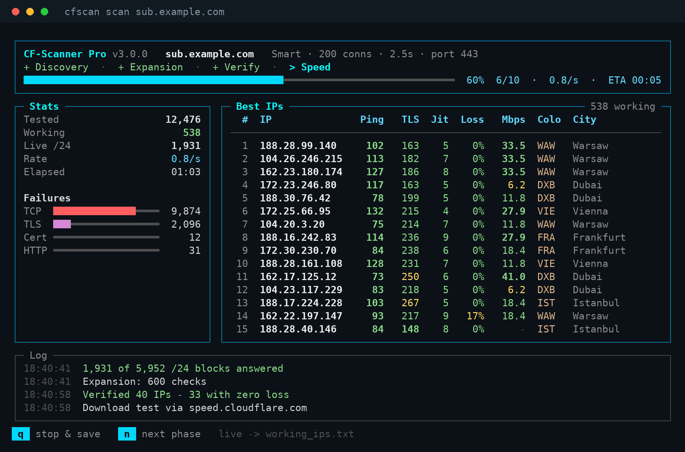

<div align="center">

# CF-Scanner Pro

**Find clean, fast Cloudflare edge IPs for your own domain (SNI) — straight from your terminal.**


[](https://github.com/SandBaad/CF-Scanner-Pro/actions/workflows/tests.yml)
[](https://github.com/SandBaad/CF-Scanner-Pro/releases/latest)


[English](#english) • [فارسی](#persian)

</div>

<p align="center"></p>
<p align="center"><sub>Example screen</sub></p>

---

<a name="english"></a>
## English

### Why v3
- **Zero dependencies.** No `pip install` — nothing to break on Termux or on a filtered network.
- **Results you can trust.** An IP only counts if it passes **TCP → TLS with your SNI (certificate verified) → `/cdn-cgi/trace`**, and the trace must echo *your* host. Hijacked or transparent-proxied answers are rejected.
- **Real quality numbers.** The best IPs are re-tested several times for **median latency, jitter and packet loss**, then get a **real download test**. Ranking weighs all of it, so a throttled IP with a fast handshake can't come out on top.
- **Smart search.** Samples every /24 of Cloudflare, then digs only into the fastest blocks.
- **Command-based** with a live full-screen dashboard (auto-adapts to phone screens), plus `--plain` and `--json` for scripts.
- **Safe output.** IPs are written while scanning; `q` or `Ctrl+C` stops cleanly and saves.

### Windows (no Python needed)
1. Download **`cfscan.exe`** from the [latest release](https://github.com/SandBaad/CF-Scanner-Pro/releases/latest).
2. **Double-click it**, type your domain, pick a mode, done. Your domain is remembered for next time.
3. Results (`working_ips.txt`, `results.csv`) are saved next to `cfscan.exe`.

From a terminal (Windows Terminal, PowerShell or cmd) every command below works too: `.\cfscan.exe scan sub.example.com`.

> Windows may show **"Windows protected your PC"** because the file isn't code-signed: click **More info → Run anyway**. The exe is built by GitHub Actions straight from this repository ([workflow](.github/workflows/windows.yml)).

### Install (Linux, macOS, Termux, or Windows with Python)
```bash
git clone https://github.com/SandBaad/CF-Scanner-Pro.git
cd CF-Scanner-Pro
python3 main.py scan sub.example.com
```
Termux: `pkg install python git` first. Windows with Python: use `py main.py` instead of `python3 main.py`. Optional: `pip install .` gives you a `cfscan` command (same as `python3 main.py`).

### Commands
| Command | What it does |
|---|---|
| `cfscan scan SNI` | Scan Cloudflare ranges and rank the IPs that work for your SNI |
| `cfscan test IP/CIDR…` | Re-check specific IPs (`-f working_ips.txt` to re-check your last results) |
| `cfscan ranges [update]` | Show the ranges, or download the latest list from Cloudflare |
| `cfscan show` | Print the last results again (`--ips` for a plain list) |

Keys during a scan: **`q`** stop & save · **`n`** skip to the next phase.

### Modes (`-m`)
| Mode | How | Time* |
|---|---|---|
| `quick` | 1 IP per /24 → re-test best 20 → speed-test 5 | ~1 min |
| `smart` | 2 per /24 → dig 24 more IPs in the 25 fastest /24s → re-test 40 × 5 → speed-test 10 | ~2–3 min |
| `deep` | 4 per /24 → dig 60 more in the 80 fastest /24s → re-test 80 × 6 → speed-test 15 | ~6 min |
| `full` | every IP (~1.5M) | hours |

\* depends on your network.

### Useful options
```bash
cfscan scan sub.example.com --colo FRA,AMS,IST     # only these data centers
cfscan scan sub.example.com -p 8443 -t 3           # other HTTPS port, longer timeout
cfscan scan sub.example.com -n 50                  # stop discovery after 50 working IPs
cfscan scan sub.example.com --speed-url https://sub.example.com/10mb.bin
cfscan scan --save sub.example.com                 # remember settings → next time just: cfscan scan
cfscan scan sub.example.com --json > result.json   # for scripts
```
Run `cfscan scan -h` for everything.

**About the speed test:** by default it downloads 2 MB from `speed.cloudflare.com` through each IP. If that host is filtered on your network the scanner notices, skips the test and tells you — use `--speed-url` with a file on your own domain, or `--no-speed`.

### Output
| File | Content |
|---|---|
| `working_ips.txt` | Working IPs, best first |
| `results.csv` | Ping, TLS, jitter, loss, Mbps, colo, city for every IP |
| `results.json` | Same as CSV plus scan info (used by `cfscan show`) |

> For the HTTP check your domain must be proxied by Cloudflare (orange cloud). If it isn't, add `--no-http`.

---

<a name="persian"></a>
<div dir="rtl" align="right">

## فارسی

**CF-Scanner Pro** آی‌پی‌های تمیز و سریع کلودفلر را برای دامنه (SNI) خودتان پیدا می‌کند — مستقیم از ترمینال.

### چرا نسخه ۳
- **بدون هیچ پیش‌نیازی:** دیگر `pip install` لازم نیست؛ روی Termux و اینترنت فیلترشده هم بدون دردسر اجرا می‌شود.
- **نتایج واقعی:** یک آی‌پی فقط وقتی سالم حساب می‌شود که اتصال TCP، سپس TLS با SNI شما (با بررسی گواهی) و در آخر درخواست `/cdn-cgi/trace` همه موفق باشند و پاسخ هم دقیقاً برای دامنه شما باشد. پاسخ‌های جعلی یا دست‌کاری‌شده رد می‌شوند.
- **کیفیت واقعی اتصال:** بهترین آی‌پی‌ها چند بار دوباره تست می‌شوند (میانه پینگ، جیتر و درصد loss) و بعد **تست دانلود واقعی** می‌گیرند. رتبه‌بندی همه این‌ها را با هم در نظر می‌گیرد، پس آی‌پی‌ای که فقط هندشیک سریعی دارد ولی سرعت دانلودش محدود شده بالای لیست نمی‌آید.
- **جستجوی هوشمند:** از همه رنج‌های /24 کلودفلر نمونه می‌گیرد و فقط در سریع‌ترین رنج‌ها عمیق‌تر می‌گردد.
- **دستوری (Command-based)** با داشبورد زنده تمام‌صفحه که خودش را با صفحه گوشی هم تطبیق می‌دهد؛ برای اسکریپت هم `--plain` و `--json` دارد.
- **ذخیره امن:** نتایج حین اسکن ذخیره می‌شوند و با `q` یا `Ctrl+C` اسکن تمیز متوقف و ذخیره می‌شود.

### ویندوز (بدون نیاز به پایتون)
1. فایل **`cfscan.exe`** را از [آخرین نسخه (Releases)](https://github.com/SandBaad/CF-Scanner-Pro/releases/latest) دانلود کنید.
2. **روی آن دوبار کلیک کنید**، دامنه‌تان را بنویسید و حالت اسکن را انتخاب کنید. دامنه برای دفعه بعد ذخیره می‌شود.
3. نتایج (`working_ips.txt` و `results.csv`) کنار همان `cfscan.exe` ذخیره می‌شوند.

همه دستورهای پایین در ترمینال ویندوز (Windows Terminal، PowerShell یا cmd) هم کار می‌کنند: `.\cfscan.exe scan sub.example.com`

> چون فایل امضای دیجیتال ندارد، ممکن است ویندوز پیام **«Windows protected your PC»** نشان دهد. روی **More info** و بعد **Run anyway** بزنید. این فایل را خود GitHub Actions مستقیم از کد همین ریپو می‌سازد.

### نصب و اجرا (لینوکس، مک، Termux یا ویندوزِ دارای پایتون)

<div dir="ltr" align="left">

```bash
git clone https://github.com/SandBaad/CF-Scanner-Pro.git
cd CF-Scanner-Pro
python3 main.py scan sub.example.com
```

</div>

در Termux اول `pkg install python git` را بزنید. در ویندوزِ دارای پایتون به جای `python3 main.py` بنویسید `py main.py`. اگر بخواهید دستور کوتاه `cfscan` داشته باشید: `pip install .`

### دستورها

<div dir="ltr" align="left">

```bash
cfscan scan sub.example.com            # اسکن رنج‌های کلودفلر
cfscan test 104.16.1.10 172.67.0.0/28  # تست دوباره آی‌پی‌های مشخص
cfscan test -f working_ips.txt         # تست دوباره نتایج قبلی
cfscan ranges update                   # به‌روزرسانی رنج‌ها از کلودفلر
cfscan show                            # نمایش دوباره آخرین نتایج
```

</div>

کلیدها حین اسکن: **`q`** توقف و ذخیره · **`n`** رفتن به مرحله بعد

### حالت‌ها (`-m`)
- **quick:** از هر /24 یک آی‌پی؛ سریع‌ترین حالت (حدود ۱ دقیقه).
- **smart (پیشنهادی):** از هر /24 دو آی‌پی، سپس جستجوی بیشتر در ۲۵ رنج سریع‌تر، تست مجدد ۴۰ آی‌پی برتر و تست سرعت ۱۰ آی‌پی اول.
- **deep:** دقیق‌تر و کامل‌تر (حدود ۶ دقیقه).
- **full:** همه آی‌پی‌ها (خیلی کند).

### گزینه‌های پرکاربرد

<div dir="ltr" align="left">

```bash
cfscan scan sub.example.com --colo FRA,AMS,IST   # فقط این دیتاسنترها
cfscan scan sub.example.com -p 8443 -t 3         # پورت دیگر و تایم‌اوت بیشتر
cfscan scan --save sub.example.com               # ذخیره تنظیمات؛ دفعه بعد فقط: cfscan scan
cfscan scan sub.example.com --speed-url https://sub.example.com/10mb.bin
```

</div>

**درباره تست سرعت:** به‌صورت پیش‌فرض ۲ مگابایت از `speed.cloudflare.com` از طریق هر آی‌پی دانلود می‌شود. اگر این دامنه روی اینترنت شما فیلتر باشد، اسکنر خودش متوجه می‌شود، تست را رد می‌کند و به شما می‌گوید؛ در این حالت با `--speed-url` یک فایل روی دامنه خودتان بدهید یا از `--no-speed` استفاده کنید.

### خروجی
- فایل `working_ips.txt`: آی‌پی‌های سالم، مرتب از بهترین.
- فایل `results.csv`: پینگ، TLS، جیتر، loss، سرعت (Mbps)، دیتاسنتر و شهر.
- فایل `results.json`: همان اطلاعات به‌همراه مشخصات اسکن (برای `cfscan show`).

> برای تست HTTP، دامنه شما باید پشت پروکسی کلودفلر (ابر نارنجی) باشد؛ در غیر این صورت از `--no-http` استفاده کنید.

</div>

---

## Disclaimer
This tool is for network analysis and educational purposes. Use it only on domains and networks you're allowed to test.
